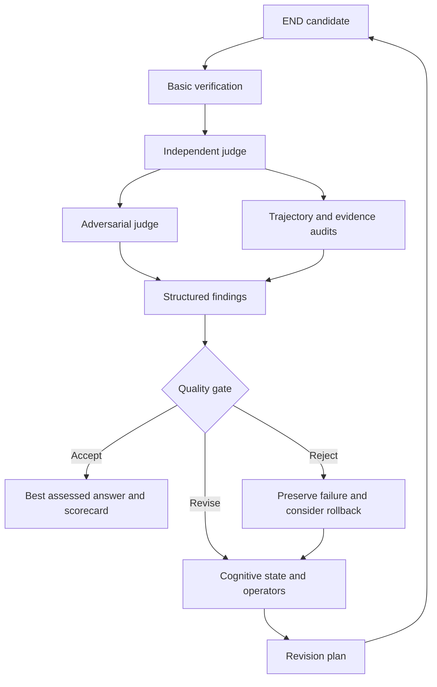
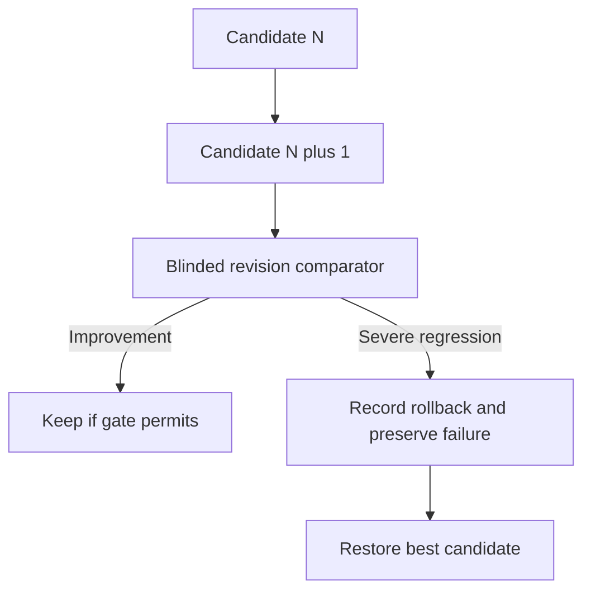
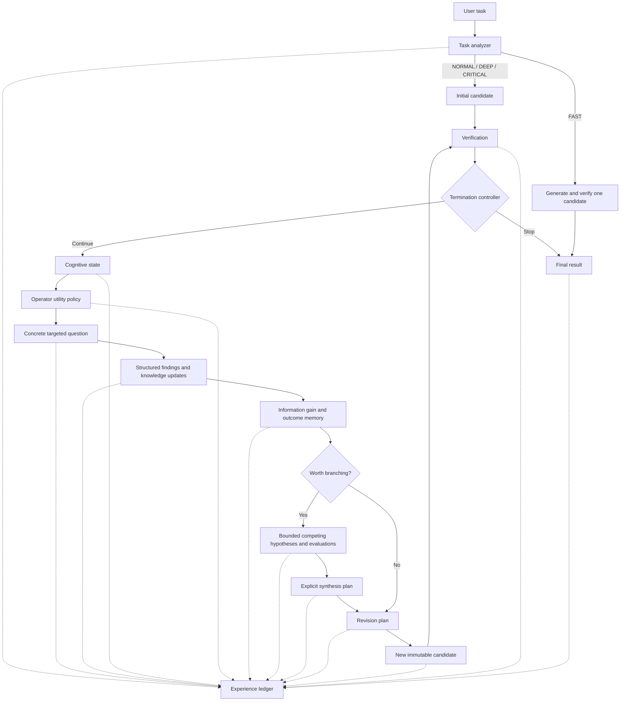

# END Engine v0.3.4 — Trajectory Quality Gate and Adversarial Judge

v0.3.1 is a focused audit-policy fix, and v0.3.2 reconciles the final assessment of a restored candidate. v0.3.3 adds
bounded evidence-integrity checks: explicit references, declared claim mappings, scope and contradictions. v0.3.4 fixes
three defects in them. See "v0.3.3/v0.3.4 evidence integrity", "v0.3.1 audit policy", "v0.3.2 final reconciliation"
below and IMPLEMENTATION_REPORT.md.

These checks are **not hallucination detection or fact-checking**. They check how model statements use evidence
recorded in the run. They do not establish whether the content of an answer is true.

END is an external orchestration system that subjects a candidate answer to adaptive
criticism, explicit revision planning, and verification. It exists to produce more
inspectable solutions and reusable experience records. It does not give an LLM
persistent cognition or change its weights.

v0.2 adds a run-local cognitive state and utility policy: **what should be
investigated next, which uncertainty does it target, and what new information is
expected?** Competing hypotheses can be evaluated in bounded branches and their
useful components explicitly synthesized before revision.

v0.3 adds independent judging, adversarial review, evidence audits, revision
comparison, a formal quality gate, and rollback to an earlier best candidate.
The new layer judges explicit artifacts, not undocumented model reasoning.

This foundation runs locally with **Python 3.11+**, the standard library, no API
keys, and no runtime dependencies. The default provider is an explicitly synthetic,
deterministic mock. No live provider adapter, training, UI, self-modification, or
dataset transformation is included.

## Run

From the repository root:

```sh
python -m end_engine.demo
python -m end_engine.demo_v02
python -m end_engine.demo_v03
python -m unittest discover -s tests -t . -v
```

On this Windows workspace, Python is available through Codex's bundled runtime.
The launcher locates it automatically if `python` is absent from PATH:

```powershell
.\run-demo.ps1
.\run-demo.ps1 -V02
.\run-demo.ps1 -V03
```

The v0.1 memory demo remains supported. Each demo prints candidates, selections, critiques, weaknesses, plans, verification,
and termination, followed by the **complete trajectory JSON**. It writes:

- `demo_output/demo_trace.txt`: readable execution trace.
- `demo_output/demo_trajectory.json`: pretty-printed complete record.
- `demo_output/<trajectory_id>.jsonl`: one complete machine-readable record.

`--output-dir PATH` selects an output directory; `--verbose` enables progress logs.
The PowerShell equivalents are `-OutputDir PATH` and `-VerboseTrace`.
Mock content and decisions are deterministic; UUIDs, timestamps, and latency vary.

The harder v0.2 demo designs a production-code modification agent. It writes the
full trace, pretty JSON, and UUID JSONL to `demo_v02_output/`. It uses the normal
utility policy with `ProductionAgentMockProvider` and CRITICAL mode, without an
enforced operator sequence. It describes an agent design; it never modifies a
production codebase or deploys anything.

The v0.3 deployment-controller demo writes `demo_v03_output/`. It exposes an
optimistic verifier, corrects a hidden rollback flaw, executes a bounded abstract
recovery model, accepts C3, then rejects C4 and returns C3. No actual deployment runs.

## Strict quality evaluation

```python
from end_engine import EndEngine, EngineConfig, MockProvider
from end_engine.quality.mock import MockJudgeProvider

engine = EndEngine(
    EngineConfig(ledger_dir="trajectories"),
    provider=MockProvider(),
    judge_provider=MockJudgeProvider(),
    secondary_judge_provider=MockJudgeProvider(model="second-judge-fixture"),
)
result = engine.run("Design bounded persistent memory.", mode="deep")
print(result.quality_gate, result.acceptance_label)
print(result.best_candidate_id, result.latest_candidate_id)
```

Supplying a primary judge enables strict v0.3 evaluation and schema 3.0.
`EngineConfig(quality_evaluation=True)` also enables it with an offline mock judge.
`JudgeProvider` exposes structured evaluation and metadata, separately from generation;
`ModelJudgeProvider` adapts an existing ModelProvider. Primary, optional secondary,
and adversarial roles can use distinct models, and all calls are recorded.
Same-model/different-instance use is supported but limits verified acceptance.

### v0.3.3/v0.3.4 evidence integrity: model claims are never verification

A claim does not become verified because it is detailed, repeated, confidently stated, or agreed with by another model.
After the judgments of each candidate, END runs a deterministic evidence-integrity pass (`end_engine/quality/integrity.py`).
It makes no model calls, and it never repairs, substitutes or drops a model statement or reference. Each candidate's
result is recorded as an `evidence_integrity` step and collection entry. The returned candidate's view appears in
`scorecard.evidence_integrity`.

**Evidence model.**
- **Trusted evidence** is only an `EXECUTED_EVIDENCE` artifact produced by the configured tool verifier (trusted code,
  such as the Harness check executor or a `CallableToolVerifier` callback) for **this candidate**.
- A PASS supports a claim only inside its declared scope:
  - The claim's ID is in the artifact's `targets`.
  - If the optional `CheckContract` binds `artifact_sha256`, it equals the SHA-256 of the exact candidate content.
  - If the contract lists `claims`, the claim's text is one of them.
  - A claim about final-task success or complete correctness (a deliberately narrow pattern such as "final evaluation",
    "hidden tests", "all constraints are satisfied", "fully correct") needs a contract with `phase="final"`.
- A failed check contradicts a claim only when it checked this exact artifact.
- Evidence without a contract (for example, current Harness receipts) keeps its v0.3.2 target-based meaning, and its
  phase is *undeclared*.
  - It cannot support a claim that matches the final-scope phrase list.
  - Any other claim it targets is supported exactly as the trusted checker mapped it. For example, the Harness maps
    receipts only to the exact text of its registered scope, such as "The declared development checks pass for this
    task input."
- **A PASS must cover something (v0.3.4).** A PASS counts toward verified acceptance only if it targets a recorded
  claim, weakness or assumption. A receipt that covers nothing adds "Executed checks cover no recorded claim or
  concern…".
- **Everything else is model-reported:** `MODEL_JUDGMENT` artifacts, judge verdicts, scores, confidences and
  uncertainties; statuses the model sets through critique `claims`/`claim_updates` (`SUPPORTED`, `NOT_APPLICABLE`);
  risk acceptance; and transition rationales.
- **Provenance comes from the writer, not the wording (v0.3.4).** A status counts as Engine-written only when this
  session wrote that exact `(claim, status, evidence)` update. Evidence text that imitates the Engine's
  "Executed evidence references: …" wording is still model-asserted, and its references are resolved.

**Claim and statement states** (`history` records the path; the last entry is the status):

| State | Meaning |
|---|---|
| `model_claimed` | A model or candidate asserted it; no trusted evidence. Includes model-set `SUPPORTED`/`NOT_APPLICABLE`. |
| `evidence_referenced` | The model cited evidence (an intermediate step, always followed by one below). |
| `evidence_validated` | Every citation resolves to evidence recorded for this candidate, but no trusted check covers the statement. |
| `checker_supported` | An in-scope trusted PASS exists (intermediate step). |
| `verified` | An in-scope trusted PASS, and no in-scope failure or contradiction. Only claims reach this state. |
| `unresolved` | A citation does not resolve, or the evidence or judgments contradict each other. |
| `unsupported` | Evidence was used outside its scope (for example, development evidence for a final-task statement), or a trusted check failed. |

**References.** END resolves explicit references in:
- judge `evidence` lists and issue evidence;
- judge uncertainty and issue text;
- model-authored claim evidence;
- transition rationales made on this candidate.

It recognises bounded forms: execution UUIDs, `receipts/….json` sources, content or artifact hashes of 12 or more hex
characters, END IDs (`E-C0-1`, `AT001`, `J001`, `AJ001`, `CL001`, `W001`, `A001`) and `step N`. Each one is `valid`,
`nonexistent`, `wrong_candidate` (it exists but belongs to another candidate, even with byte-identical content) or
`wrong_artifact`. A judge citing unknown evidence no longer aborts the run (0.3.2 raised, and the run ended as
`EXTERNAL_BLOCKER` with the judgment lost). The judgment is kept exactly as written, with `unresolved_evidence`.

**Contradictions.** For each claim, weakness or assumption ID, END collects:
- **Supporting stances:** in-scope trusted PASSes, and PASS judgments citing an artifact that targets the ID.
- **Opposing stances:** trusted FAILs, and judge issues targeting the ID.

If both exist, END records the conflict with both sides and chooses neither, by recency, confidence or any other means.

**Effect on the gate.** Integrity findings are added as gate uncertainties. They cap the decision at
`ACCEPT_PROVISIONALLY` and never create `REVISE`/`REJECT` on their own. The findings are:
- unresolved references;
- evidence used outside its scope;
- unresolved contradictions;
- model-asserted claim status without trusted evidence;
- executed evidence bound to a different artifact;
- executed checks that cover no recorded claim or concern (v0.3.4).

Existing rules are unchanged. A real failed check still gives `REVISE`, or `REJECT` for a HIGH claim, and judge findings
still escalate as before. Thresholds, budgets, termination, candidate selection and rollback are unchanged.
Reconciliation changes only as described under "Byte-identical candidates" below. Accepted risks stay listed as
`unresolved`. Model agreement is recorded as `model_agreement` with
`counts_as: "corroboration only; never independent verification"`.

**Scorecard (`scorecard.evidence_integrity`).** It reports:
- `status_counts` and `verified_claims`;
- `not_verified` (every claim short of verified, and every unresolved or unsupported statement, with its reason);
- `unresolved_references`, `contradictions`, `trusted_evidence` (phase, check ID, artifact binding) and `model_agreement`;
- `accepted_risks`;
- `blocks_verified_acceptance`.

`known_uncertainties` is now de-duplicated, which removes the repeated AJ001 line seen in smoke 8b553c71.

**Byte-identical candidates (v0.3.4).** Integrity is evaluated per candidate. When the returned candidate has
byte-identical siblings, reconciliation classifies the siblings' integrity findings. It does not transfer a finding
merely because the bytes match.

| Finding on a sibling | Treatment |
|---|---|
| A contradiction about a claim or concern, or a trusted check of that claim that failed | Kept unresolved and visible, and caps acceptance at `ACCEPT_PROVISIONALLY`. Never a failure. |
| — whose failed check binds this exact content (`artifact_sha256`) | Applicability `demonstrated`. |
| — otherwise | Applicability `undetermined`. |
| The same, but the concern was later resolved on that content by a transition audited `VALID` | `resolved_later`; no cap. |
| Citation errors (`nonexistent`, `wrong_candidate`), another judge's out-of-scope statements, checks bound to a different artifact, and claim statuses or mappings in that candidate's scope | Listed in `not_transferred` (kind `evidence_integrity`), not applied. |

Where the results appear:
- `final_reconciliation.integrity_findings`;
- `scorecard.evidence_integrity.identical_content_findings`;
- the reconciled gate reasons.

Historical per-candidate records, candidate selection, rollback and termination are unchanged.

**What is covered.**
- Explicit references in the bounded forms above, resolved against what was recorded.
- Claim support only through trusted checker targets, optional declared statements, artifact binding and phase.
- Contradictions between trusted checks and judge issues that target a recorded ID.
- Model-set statuses, accepted risks and model agreement are never counted as verification.

**Remaining gaps.**
- Detection covers only the bounded reference forms above. Prose such as "the earlier test" is not treated as a
  citation.
- The final-scope pattern is a narrow list of phrases, not a fact checker. A differently worded final-task claim that a
  trusted checker targets can still be supported by that checker's PASS.
- Declared `claims` match normalized exact text, so a paraphrased claim does not match.
- A check with neither `claims` nor a contract is trusted for its declared targets, as before.
- Statements in the candidate content, critique findings and weakness texts are not fact-checked or scanned. A false
  statement that cites nothing is not detected.
- Judge issues that target `candidate` rather than a recorded ID never form a contradiction.

### v0.3.2 final reconciliation of the returned candidate

When a strict run ends, END still returns its selected best candidate. Selection and rollback are unchanged. Before finalizing, it reconciles that candidate's recorded evaluation with later information that demonstrably applies to it. This makes no model calls, and it is recorded as a `final_reconciliation` step and trajectory key, with its basis, the original and reconciled gates, applied and ignored transitions, and non-transferred items.

**Applied:**
- Critique findings on **byte-identical** candidates, recorded after the returned candidate's gate.
- Status transitions made on byte-identical candidates, but only when an audit in that same content scope rated them `VALID` or `WEAKLY_SUPPORTED`. A later valid resolution therefore stays resolved.

**Not applied:**
- Transitions on different content.
- Invalid or unaudited transitions. Unaudited ones add an uncertainty.
- Judge feedback and audit failures of other candidates. These are candidate-scoped: audit failures are only listed, and judge feedback on identical content is reported as "Applicability undetermined…", which caps acceptance at provisional.

**Effects:**
- A later unresolved high or critical concern makes the final `quality_gate` `REVISE`.
- An applicable accepted risk caps it at `ACCEPT_PROVISIONALLY` ("Accepted risks remain unverified…").

**Field meanings:**
- `best_candidate_id` / `final_candidate_id` is the returned answer.
- `quality_gate`, `acceptance_label` and `scorecard` give the reconciled final assessment of that answer. The historical `quality_gate_decisions` are never modified.
- `weaknesses` and the last cognitive state show the concerns applicable to the returned answer. `scorecard.unresolved_concerns` lists the open concerns and accepted risks.
- `termination` says why the loop stopped. For example, `BUDGET_EXHAUSTED` or `EXTERNAL_BLOCKER` stays as it is, while concerns are still reported. `verification` remains the returned candidate's own verifier result.

### v0.3.1 audit policy: procedural failures and accepted risk

- **An INVALID resolution or assumption audit is a procedural failure, not a candidate defect.**
  - The unsupported transition is rejected. The weakness reopens at its **own** severity, and the assumption returns to `UNTESTED`.
  - An `audit_failure` step records the target, the criteria that were not met, the action taken and the retained severity.
  - The audit remains `INVALID` in `resolution_audits` / `assumption_audits`, and it still adds its reason to the gate's `REVISE` reasons.
  - No new weakness is created, so a low-severity concern no longer escalates to high. A high or critical concern, or a HIGH/CRITICAL-risk assumption, still blocks through the existing rules.
- **Accepting a weakness as a risk without executed evidence or a targeted revision** is `WEAKLY_SUPPORTED` only if all of these hold:
  - severity is `low` or `medium`;
  - the justification has at least 40 characters and does not merely restate the concern;
  - no executed evidence for the candidate failed;
  - both independent and adversarial judgments of the same candidate are `PASS` / `ACCEPT`, with no fatal or major issues.

  Otherwise the audit is `INVALID` and lists its `criteria_gaps`. Corroborating judgment IDs are kept in the audit.
- **An accepted risk never counts as verification.** The gate adds "Accepted risks remain unverified: …", so the best outcome is `ACCEPT_PROVISIONALLY`.
- Claiming `resolved` without a revision or evidence remains `INVALID`, exactly as before.

For backward compatibility, unconfigured runs keep the v0.2 path, schema 2.0 and
legacy stop reasons. They now explicitly report an unjudged scorecard,
`quality_gate="BLOCKED"`, and INCONCLUSIVE (or INCOMPLETE on failure). A legacy
QUALITY_THRESHOLD_REACHED is not independent v0.3 acceptance. Existing tests and
v0.1/v0.2 demos remain supported without being relabeled as verified.

| Component | Responsibility |
| --- | --- |
| CandidateJudge / Judgment | PASS, NEEDS_REVISION, FAIL or INCONCLUSIVE; dimension scores and confidence; fatal/major/minor issues, uncertainty and evidence references |
| AdversarialJudge | Seek circularity, unsupported claims, contradictions, lost constraints, superficial verifier satisfaction and reframing that evades the original goal |
| TrajectoryJudge | Audit substantive discoveries, redundancy, resolution integrity, evidence provenance and rejected components imported by synthesis |
| RevisionComparator | Blinded A/B preferences, per-dimension deltas and STRONG_IMPROVEMENT, IMPROVEMENT, MIXED, NO_MATERIAL_CHANGE, REGRESSION or SEVERE_REGRESSION |
| ClaimValidator | Candidate/target-bound ClaimValidationResult; model fluency or a self-assigned SUPPORTED label is not executed evidence |
| ResolutionAuditor | VALID, WEAKLY_SUPPORTED or INVALID weakness and assumption transitions; a changed label without revision/evidence is invalid |
| AdversarialTestGenerator | Concrete scenarios and observable properties with explicit execution status |
| ToolVerifier | Explicit trusted callback hook for scoped EXECUTED_EVIDENCE, separate from MODEL_JUDGMENT |
| VerifierGamingDetector | Heuristic signals for unsupported certainty, verifier vocabulary, repetitive length, dropped explicit constraints and reframing/caveat escape |

Judges see anonymous candidate content and the original task, without candidate
iteration, lineage, generator verifier scores or success labels. Pairwise aliases
map back to candidate IDs only after comparison. Content can still reveal clues;
blinding reduces status bias rather than guaranteeing anonymity.

Primary/secondary disagreement produces DISPUTED, with disputed dimensions; verdicts
are never blindly averaged. Low confidence (default threshold 0.75), unresolved
uncertainty, and absent evidence prevent verified acceptance. Confidence is an
explicit heuristic, not statistically calibrated certainty. Fatal issues override
average scores. Important contradicted claims prevent acceptance; high-impact
unverified claims cannot qualify as verified merely through fluent explanation.

`QualityGate` combines verification, primary/adversarial judgments, fatal issues,
disputes, confidence, cognitive state, coverage, claim validations, assumption and
resolution audits, comparison, trajectory integrity, gaming signals and evidence:

| Decision | Meaning |
| --- | --- |
| REJECT | Fatal flaw, high-impact contradiction, severe regression or rejected synthesis component |
| REVISE | Correctable issue, invalid audit, failed check, unresolved severe uncertainty or missing critical scrutiny |
| BLOCKED | Missing/inconclusive judgment or unresolved judge dispute |
| ACCEPT_PROVISIONALLY | Otherwise acceptable, with limited evidence, confidence or independence |
| ACCEPT_VERIFIED | Independent judgments and scoped executed checks meet configured requirements |

**ACCEPT_VERIFIED is limited to the scope of recorded checks**, not proof of all
real-world behavior. The demo executes six event orderings in a small abstract
rollback state machine; its model judgments remain synthetic. It does not validate
an actual deployment controller or establish a production safety guarantee.

Strict successful stop reasons are ACCEPTED_VERIFIED and ACCEPTED_PROVISIONALLY.
Judge findings feed back into weaknesses and cognitive targets such as EVIDENCE,
VERIFY, WHAT_BREAKS or COUNTEREXAMPLE, without directly rewriting candidates.
An optimistic generator verifier cannot bypass the gate. Budgets still bound the run.

Best and latest candidate IDs are tracked separately. Severe regression records a
rollback event, preserves the rejected candidate and judgments, and restores the
best candidate's verification and knowledge/weakness state. IDs are not reused.
Positive complexity_cost means additional burden; increased cost without benefit
counts as regression. A clarity gain cannot cancel severe correctness or recovery
regressions. `post_acceptance_cycles=1` permits one extra bounded research probe;
the demo uses it to expose C4 after C3 passes. It is disabled by default.

Every completed strict trajectory receives ACCEPTED_HIGH_CONFIDENCE,
ACCEPTED_PROVISIONAL, REJECTED_REGRESSION, REJECTED_FATAL, INCONCLUSIVE or INCOMPLETE.
Transitions record GOOD_REVISION, BAD_REVISION, RECOVERY_REVISION or NO_MATERIAL_CHANGE.
A fatal gate rejection cannot become a GOOD_REVISION even if comparison prefers its
wording. Pairwise preferences, deltas, failed revisions and corrections are retained
for future research; no exporters, preference training or Harness-Zero are implemented.

Generated test statuses UNEXECUTED, REASONED and EXECUTABLE do not attest execution.
Model-claimed SIMULATED output is normalized to REASONED. Actual checks are separate
evidence records with candidate IDs and optional test IDs. CallableToolVerifier
invokes only a caller-supplied trusted Python callback returning ToolCheck records;
there is no model-generated shell/code execution API. Callbacks must report their
real check scope honestly. Real compiler, numerical and external evaluators can be
implemented behind this hook later. Custom callback I/O is trusted extension code.





## API and recursion

```python
from end_engine import EndEngine, EngineConfig, MockProvider

engine = EndEngine(EngineConfig(ledger_dir="trajectories"), provider=MockProvider())
result = engine.run(
    task="Design a persistent memory architecture for an AI agent.",
    mode="deep",
    max_cycles=6,
)
print(result.answer)
print(result.as_dict())
```

The analyzer uses task shape, constraint count, question count, scope, and domain
signals. Optional LLM classification uses a separate structured call. Explicit
`mode="fast" | "normal" | "deep" | "critical"` overrides classification.

| Mode | Minimum cycles | Target cycles | Maximum cycles |
| --- | ---: | ---: | ---: |
| FAST | 0 | 0 | 0 |
| NORMAL | 1 | 2 | 3 |
| DEEP | 2 | 4 | 6 |
| CRITICAL | 3 | 5 | 8 |

A cycle is one critique → plan → revision → verification. C0 is generated and
verified before cycle 1. FAST uses one candidate and verification without recursion.
An explicit `max_cycles` replaces the cap and clamps the minimum and target to it;
zero permits only C0. FAST remains zero-cycle even with a larger cap. The target
influences question selection; it is not a mandatory stopping point.

An additional shared cognitive-operation budget bounds investigations and branches.
Each operator invocation and each generated branch costs one unit. By default this
budget is `max_cycles + max_branches_per_operator`; set `max_cognitive_operations`
to cap it explicitly. These are orchestration units, not token or model-call counts.



The default selector ranks operators from structured cognitive state using explicit
utility factors. An optional LLM selector receives compact state and the utility
ranking, with a repeat guard. Both are replaceable policies. Enable LLM assistance with
`EngineConfig(llm_classification=True, llm_selection=True)`.

## Cognitive state, questions, and utility

`CognitiveState` contains the candidate ID, iteration, provisional verifier-derived
resolved dimensions, uncertain dimensions, open and severe weaknesses, active
evidence gaps, assumptions, explored branch IDs, operator/family statistics, eight
recent outcomes, improvement, stagnation, coverage, priority adjustments, and
remaining cycle/operation budgets. State snapshots come from explicit artifacts,
not private model reasoning. Provider calls receive stage-specific context; they
do not receive the full ledger. Operator knowledge context contains at most eight
current claims and eight recent assumptions, alongside the concrete selected target.

All 17 operators have introspectable metadata: family, targets, best/poor conditions,
cost, novelty bias, branch capability, preferred target types, and compatible
followups. The taxonomy and priors live in `operators/metadata.py`.

| Family | Operators |
| --- | --- |
| Foundational | WHY, HOW, WHAT, CAN |
| Adversarial | WHAT_BREAKS, WHY_NOT, COUNTEREXAMPLE |
| Epistemic | ASSUMPTION, EVIDENCE, VERIFY |
| Search | ALTERNATIVE, WHICH |
| Constraint | CONSTRAINT, IF |
| Systemic | SECOND_ORDER_EFFECT |
| Optimization | IMPROVE, SIMPLIFY |

`OperatorSelectionPolicy` is separate from the operator implementation. The default
`UtilitySelectionPolicy` uses:

```text
utility = relevance × information_gain × issue_value × novelty × task_importance
          - repetition_penalty - cost_penalty + meta_adjustment
```

Relevance reflects target fit and unexplored dimensions; issue value reflects
severity; expected gain incorporates operator and family outcomes during this run.
Novelty and repetition consider the operator, target, question intent, duplicates,
and low-value history. Same-dimension scrutiny is recognized across candidate IDs.
Repeated investigation of a genuinely different issue remains possible. Limited
remaining budget increases cost penalties. Scores are heuristic utilities, not
calibrated probabilities. Every ranking and its factors are saved in the ledger.

`QuestionGenerator` turns an operator and selected target into a `QuestionInstance`
with stable question ID, target type/ID/text, concrete question, expected information,
intent, and parent event. Target types include whole candidate, claim, assumption,
weakness, component, constraint, branch, and evidence gap. The default policy targets
weaknesses, assumptions, claims/evidence gaps, and candidate dimensions; custom
policies can use the other types. Questions are deterministic target-specific
templates, not a separate model call.

## Knowledge, information gain, and coverage

`ClaimExtractor` finds at most eight explicit assertion/requirement sentences per
candidate, capped at 1,500 characters each. Claims keep IDs, original candidate
provenance, text, type, confidence, evidence and `SUPPORTED`, `UNVERIFIED`,
`CONTRADICTED`, or `NOT_APPLICABLE` status. Exact recurring text preserves identity;
only claims in the current candidate or current critique count as active gaps.
Historical claims remain in the ledger. This extractor is intentionally lightweight
and replaceable; it does not establish whether a claim is true.

The assumption register tracks explicit assumptions and operator-discovered ones,
with risk and `UNTESTED`, `SUPPORTED`, `WEAKENED`, `INVALIDATED`, or `ACCEPTED_RISK`
status. Critiques can supply bounded `claims`, `assumptions`, `claim_updates`, and
`assumption_updates`. Status changes require existing IDs and concise evidence.
Unknown IDs and malformed updates fail visibly. Old critique responses containing
only summary/findings are still valid. `EVIDENCE` and `VERIFY` can target claims;
`ASSUMPTION` and `VERIFY` can target assumptions.

Information gain is HIGH for two or more new findings/knowledge changes/viable
alternatives, MEDIUM for one, LOW for duplicates alone, and ZERO otherwise.
Synthesis enriches the outcome with merged alternatives and a direction-change flag.
Per-operator and per-family counts influence subsequent selection. Nothing is
learned or persisted into another execution's policy.

Coverage tracks scrutiny rather than truth: NONE, LOW, MEDIUM, HIGH. Useful operator
outcomes contribute to relevant dimensions; zero-gain calls add no coverage.
Duplicate-only calls can establish LOW but cannot manufacture HIGH through repetition.
Verifier-derived resolved dimensions remain a separate provisional signal.

The pluggable `FindingDeduplicator` uses normalized text, token overlap, category,
target identity, and a conservative negation check. Its default Jaccard threshold
is 0.72. This catches lexical paraphrases, not general semantic equivalence. There
are no embeddings or vector databases.

## Bounded branches and synthesis

Branch-capable operators are ALTERNATIVE, COUNTEREXAMPLE, IF, and WHAT_BREAKS. The
default controller branches only on DEEP/CRITICAL tasks when competing approaches
or multiple unresolved severe stress cases justify the cost. FAST and NORMAL never
branch under the default policy. Default limits are:

```python
EngineConfig(
    max_active_branches=3,
    max_branch_depth=2,
    max_branches_per_operator=3,
    enable_branching=True,
)
```

The economical default explores at most one branch batch in a run. It keeps one
operation available for returning to the main candidate. The branch controller
supports parent-branch IDs and enforces depth/ancestry; the engine's default policy
does not recursively expand child branches. Branch content is a bounded hypothesis,
not an executable program.

Each branch retains parent candidate, creating operator, hypothesis, content, depth,
and transitions through ACTIVE, PROMISING, REJECTED, MERGED, or EXHAUSTED.
`BranchEvaluator` is replaceable; the default uses a separate structured model call
with task dimensions plus constraint fit and simplicity. Dimensional scores,
strengths, weaknesses, and recommendation are retained without scalar-only ranking.

`SynthesisPlanner` separately records every source branch, adopted components, and
rejected components/reasons. It can combine multiple promising branches, rejects
unknown branch IDs, and cannot adopt rejected/exhausted branches. The normal
`RevisionPlanner` consumes this plan before the candidate is rewritten. MERGED
means accepted into the synthesis plan. All rejected hypotheses remain recorded;
unresolved branches become EXHAUSTED when an error ends the run.

## Meta-checks and reframing

Every three completed cycles by default, a deterministic META_CHECK examines recent
families, low-value repetition, presentation polishing, and evidence gaps. It can
adjust family priorities toward alternatives or adversarial scrutiny, without
rewriting the candidate. Configure `meta_check_interval` to change frequency.

DEEP/CRITICAL critiques can propose one reframing per run (`max_reframings`). The
event stores the original problem, proposed framing, reason, confidence, source,
and `goal_replaced=False`. It adjusts priorities and becomes advisory input to the
revision planner. Every provider request retains the original user task.

Criticism, planning, and rewriting are distinct provider calls. Candidate records
are frozen dataclasses with tuple-valued nested state, stable IDs, parent IDs,
timestamps, strengths, weakness snapshots, and optional confidence. The engine
never modifies a previous candidate. `last_trajectory` returns a detached copy.

Weaknesses have stable IDs and persist until a verifier supplies an explicit status
update with a reason: `open`, `resolved`, `accepted_risk`, or `invalidated`. Each
transition is recorded. Re-discovering a closed weakness reopens it. Explicit IDs
and the pluggable lexical deduplicator preserve identity. Revision plans alone cannot close a weakness.

## Verification and stopping

`LLMVerifier` scores the analyzer's explicit dimensions and records remaining issues
and supported weakness updates. Overall scores are capped by the mean dimension
score. Passing also requires at least 0.8 overall, every dimension at least 0.6,
and no remaining issues. The raw model judgment is retained even if these guards
change its effective result.

`BasicRuleVerifier` checks configurable minimum length, required terms, and
forbidden terms. Its score means **rule compliance**, not semantic correctness.

After minimum scrutiny, quality termination requires a passing result, no remaining
verifier issues, no open high/critical weakness, and score ≥0.90 (≥0.95 for CRITICAL).
Noncritical work can also stop with `VERIFIER_PASSED` below the quality threshold.
Scores that improve by at most 0.01 for two consecutive revisions trigger
`NO_MATERIAL_IMPROVEMENT`; CRITICAL requires three. Repeated nonempty findings with
no material improvement can trigger `REPEATED_CRITIQUE`. The hard cap always bounds
execution, including with a custom termination controller.

v0.2 adds guards for unresolved branches and severe untested/weakened assumptions.
CRITICAL cannot report success, repetition-based stopping, or stagnation-based
stopping while major relevant coverage is NONE or active evidence gaps remain;
it continues until scrutiny completes, a budget is exhausted, or an external error
blocks execution. Major dimensions include correctness, architecture, assumptions,
failure modes, evidence, alternatives, safety, and second-order effects when relevant.
Presentation-only dimensions can remain unexamined. Three recent LOW/ZERO operations
can justify diminishing-value termination after minimum scrutiny when severe issues
and critical coverage guards allow it. Branch and operator work shares a hard budget.

`BUDGET_EXHAUSTED`, `NO_MATERIAL_IMPROVEMENT`, and `REPEATED_CRITIQUE` do **not** imply
success: inspect final verification and open weaknesses. `FAST_PATH` means recursion
was skipped, also not a correctness guarantee. Legacy mode returns the latest
candidate; strict v0.3 mode returns the best assessed candidate and supports rollback.

Provider, schema, or component exceptions terminate as `EXTERNAL_BLOCKER` while
preserving the partial trajectory. A failure before C0 returns an empty answer.
A failed verification is never replaced by a previous candidate's score. Persistence
errors propagate to the caller, with `engine.last_trajectory` available for recovery.

## What the ledger preserves

Schema versions `2.0` and `3.0` include the original task, effective classification/budget,
configuration and component names, complete operator definitions/prompts, provider
metadata, timestamps, ordered events, immutable candidate snapshots, selections and
rationales, structured critiques, weakness state transitions, revision plans,
candidate-linked verification, termination explanation, and final result.

It additionally records cognitive states, utility rankings/factors, concrete
questions and targets, claims, assumptions, information gain, outcome statistics,
branches and their evaluations, synthesis, coverage, meta-checks, and reframings.
`loads()` accepts `1.0`, `2.0` and `3.0` without changing loaded records. No migration
is needed to read old trajectories; new v0.2 fields are required only for version
2.0. Existing schema-1.0 demo records are retained as compatibility fixtures.

Strict schema 3.0 adds judgments, adversarial judgments, pairwise comparisons,
quality deltas/gates, fatal issues, disputes, claim validations, resolution/assumption
audits, adversarial tests, evidence provenance, rollback, best/latest pointers,
acceptance and transition labels, and the research scorecard. Historical records
are not destructively migrated. After rollback, top-level knowledge registers
describe the returned candidate; rejected discoveries/transitions remain in events.

Every engine-managed model call includes its exact request/context/schema, raw
response, provider/model identifiers, latency, reported token usage, tool-call
records when supplied, and errors. Run errors include their stage and traceback.
Unknown usage stays unknown; the ledger reports counts of calls with and without
usage. The engine records provider-reported tool calls but executes no tools itself.
Store no API keys in provider metadata.

```python
from end_engine.experience import JsonLedger

record = JsonLedger().load(result.trajectory_path)
assert record == engine.last_trajectory
```

One UTF-8 JSONL record is written per UUID-named file using a flushed temporary file
and atomic replacement. JSON serialization rejects non-finite numbers. All explicit
external artifacts are recorded; the engine neither requests nor relies on a model's
private internal reasoning. Analysis fields contain concise decisions, evidence,
and justifications.

The ledger is saved at normal or handled-error completion. It is not a crash-resume
journal; abrupt process termination before the final save can lose an in-progress
run. Atomic file replacement protects against partial final files, not all possible
power-loss scenarios.

## Extend the foundation

### Cognitive operator

```python
from end_engine.operators import CognitiveOperator, default_operators

operators = default_operators()
operators["PRIVACY"] = CognitiveOperator(
    name="PRIVACY",
    purpose="Find retention and access-control gaps",
    trigger_conditions=("privacy", "safety", "constraint"),
    prompt_template="Inspect sensitive-data retention and access boundaries. Identify concrete gaps.",
)
engine = EndEngine(operators=operators)
```

Call any operator independently with
`operator.execute(provider, task=task, candidate=candidate, weaknesses=())`.
It returns a validated structured critique. The engine assigns new weakness IDs.
The 17 built-ins are data-driven definitions in `end_engine/operators/__init__.py`;
they are individual calls, not one combined prompt.

### Model provider

Subclass `ModelProvider` and implement `generate(request)`,
`generate_structured(request)`, and `metadata()`. Return a `ModelResponse` with text
or JSON-compatible structured content, optional token usage, and optional tool-call
records. Structured requests carry a JSON schema, explicit stage purpose, prompt,
and context. Adapters must send that context to the model and honor the schema.
Do not silently discard `request.context`. Return a JSON object or a JSON string;
malformed output is recorded and fails the run without hidden retries.

Pass the adapter using `EndEngine(provider=adapter)`. No provider-specific SDK is
required by the core. API credentials and transport timeouts belong in the adapter.
The synchronous core cannot cancel a blocked provider call; configure a finite
network timeout in every real adapter.

`MockProvider(scripted={"critique": [response1, response2]})` supports deterministic
responses or exceptions per purpose for tests. Its default substantive answer and
critiques are memory-architecture fixtures, not a general solver. Its synthetic
verification scores do not demonstrate improved real-world reasoning quality.

### Verifier, selector, planner, analyzer, termination, or storage

A verifier implements `verify(task, candidate, trajectory) -> VerificationResult`.
Return explicit dimensions, remaining issues, and optional `WeaknessUpdate` objects.
Use `EndEngine(verifier=custom_verifier)`. `LLMVerifier(provider=separate_judge)` can
use a different judge provider; those calls are also recorded with model identifiers.
Arbitrary custom verifiers must supply their own external-tool evidence in their
results; the engine cannot intercept I/O hidden inside custom components.

The constructor also accepts `analyzer`, `selector`, `planner`, `termination`,
`operators`, and `ledger`. Their small interfaces live beside their implementations.
Selectors receive `SelectionContext`, the operator registry, and the recorded
provider. A ledger implements `save(record) -> location` and `load(location) -> dict`.
v0.2 also accepts `selection_policy`, `question_generator`, `claim_extractor`,
`deduplicator`, `branch_evaluator`, `synthesis_planner`, and `meta_controller`.
Their contracts are in `end_engine/cognition/`; for example, a selection policy
implements `rank(state, operators)` and `select(state, operators)`. Legacy custom
selectors still receive `SelectionContext`, now with a `cognitive_state` field.
Custom revision planners handling branches/reframing accept the optional `synthesis`
and `reframing` keyword arguments. Custom termination controllers retain their old
interface; built-in cognitive guards apply to the built-in controller, and engine
cycle/operation ceilings apply to all controllers.

Custom components are trusted extension code. An engine instance is intended for
sequential runs; use separate instances/providers for concurrent execution.

## Future experience distillation

Candidate lineage, raw calls, explicit operator choice, identified failures,
targeted plans, corrections, and verifier judgments preserve the relationships
needed for future quality gates, preference/rejection pairs, supervised examples,
operator datasets, and agent-as-harness experiments. Schema versioning permits
later migrations. **No transformers, Harness-Zero implementation, training,
automatic promotion, external identity/memory system, or self-modification is built.**

Model judgments remain fallible and correlated when one model generates and judges.
Real research use requires stronger task-specific checks, independent evaluation,
and cost/latency policies. v0.2 bounds cycles, cognitive operations, and branch
expansion, not tokens or wall-clock time. Policy weights, information gain, and
coverage are deterministic research heuristics. Claim/assumption evidence supplied
by a model remains a judgment, not independent proof. All default run-local state
is rebuilt for each execution.
